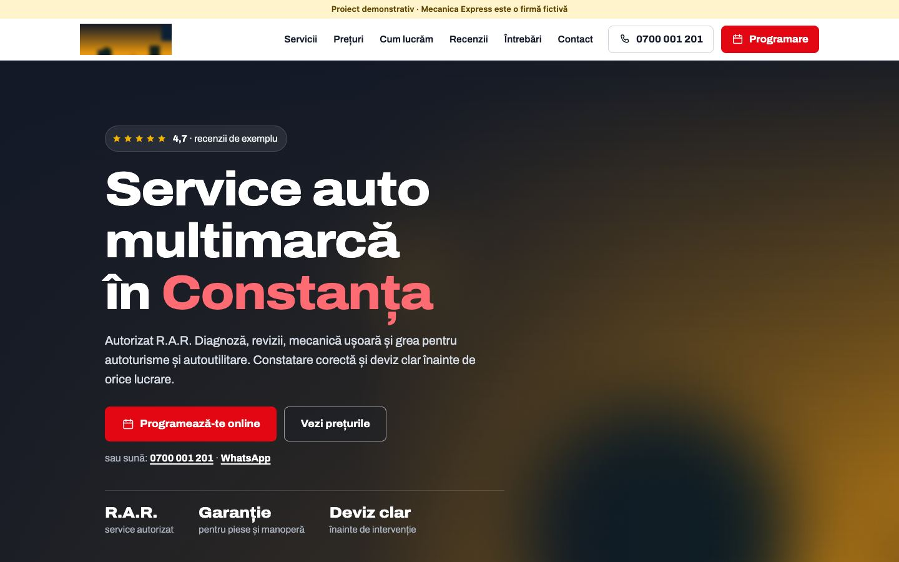
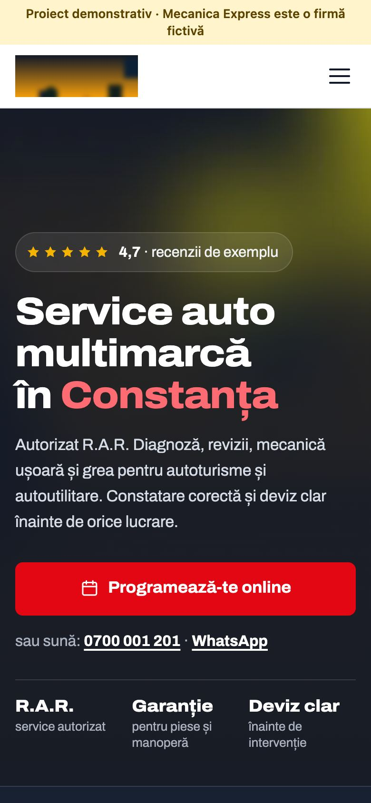
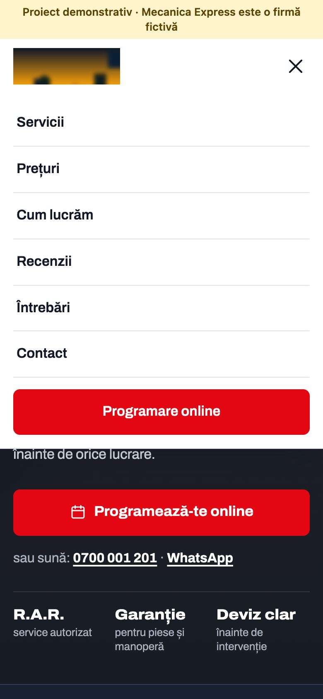
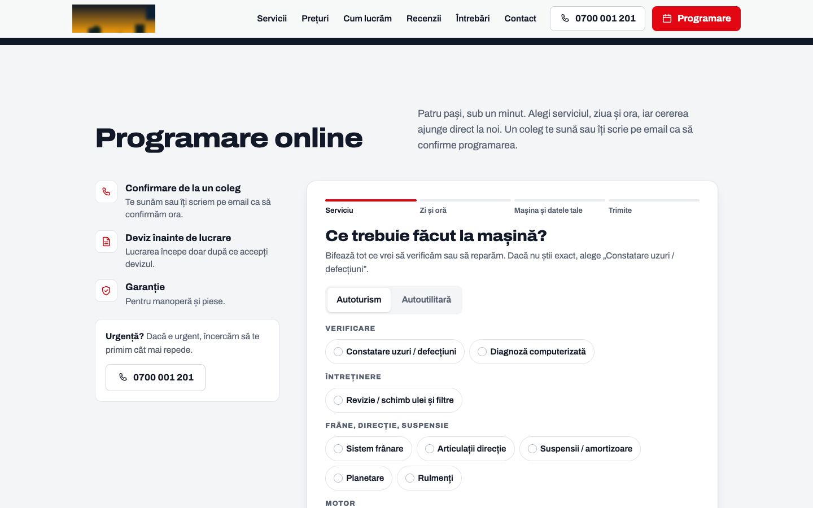
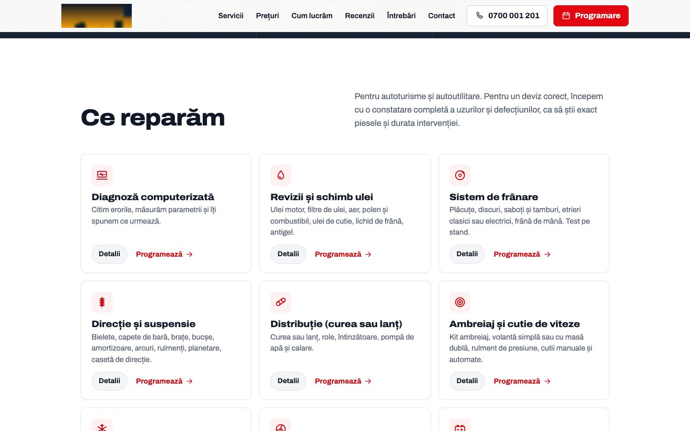

# Mecanica Express



Site de prezentare cu programări online pentru un service auto multimarcă.

> Proiect demonstrativ. Firma, adresa, telefoanele, emailurile și recenziile sunt fictive. Orice asemănare cu o firmă reală este întâmplătoare.

## Capturi de ecran

| Prima pagină, telefon | Meniul pe telefon | Programare online | Servicii |
|---|---|---|---|
|  |  |  |  |

## Tehnologii

HTML, CSS și JavaScript simplu, plus funcții serverless pe Vercel (`api/`) și Vercel Blob pentru date.

## Decizii tehnice

- Programarea online e un formular în pași (serviciu, mașină, dată, contact), cu progres salvat în localStorage.
- Programările și conținutul editabil (anunț, oferte) stau în Vercel Blob, prin funcțiile din `api/`. Dacă API-ul lipsește, site-ul arată textul implicit.
- Panoul de administrare cere un PIN din variabila de mediu `ADMIN_PIN`, verificat pe server cu comparație în timp constant.
- Detaliile celor 12 servicii se deschid într-un panou lateral, generat din date, nu din 12 pagini separate.
- Date structurate JSON-LD și harta încărcată la cerere.
- Accesibilitate: link „Sari la conținut”, mesaje anunțate cititoarelor de ecran (aria-live), focus vizibil la navigarea cu tastatura.
- Animațiile se reduc sau se opresc pentru cine a setat „reducerea mișcării” în sistem (`prefers-reduced-motion`).
- Imaginile din afara ecranului se încarcă abia când e nevoie de ele (`loading="lazy"`).

## Rulare

```bash
cd mecanica-express
npx serve .
```

## Cum a fost realizat

Proiectul a fost conceput și dezvoltat de Cristian Lucaci. În procesul de creație am folosit și instrumente de inteligență artificială, ca sprijin la scrierea codului, la texte și la verificări. Deciziile de design, alegerile tehnice și forma finală îmi aparțin.

## Licență

Codul este publicat sub licența [MIT](LICENSE), © 2026 Cristian Lucaci.

Resursele terțe incluse (fonturi, biblioteci, fotografii sau modele 3D cu licență liberă) își păstrează licențele proprii, menționate lângă fișiere sau în pagină. Imaginile fără sursă menționată sunt grafică generată pentru acest proiect.
